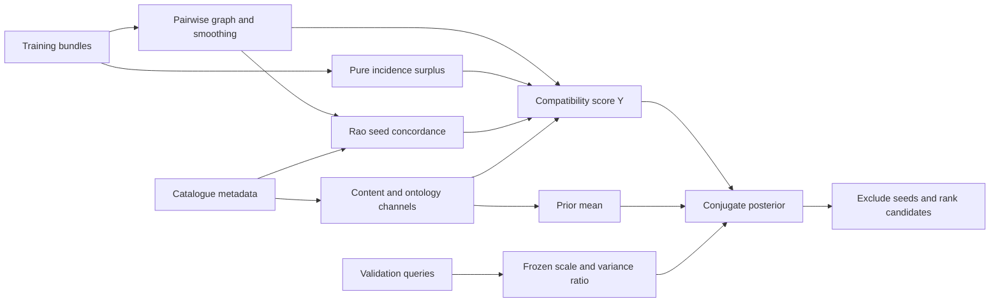

# Architecture and code map

| File | Responsibility |
|---|---|
| `simba/operators.py` | Shared incidence, concordance, graph, ontology and posterior operators |
| `simba/demo.py` | Complete offline example using bundled synthetic data |
| `simba/paths.py` | Repository-local dataset paths and environment overrides |
| `simba/data_tools.py` | Upstream downloads, local imports, inventories and title embeddings |
| `simba/fullrank_eval.py` | POG, POG_dense, Spotify and Spotify_sparse |
| `simba/bundlerec_eval.py` | Electronic, Food and Clothing; train-only user/session graphs; optional auxiliary log |
| `simba/dunnhumby_eval.py` | Grocery basket evaluation, random or chronological splits |
| `simba/ablation_study.py` | Fixed-coefficient retail ablations and per-seed JSON results |
| `simba/run_matrix.py` | Fail-closed orchestration of current measured results |

The core operators are shared, but feature banks, graph mixtures and validation
grids vary by dataset. The retail ablation uses a deliberately fixed backbone;
it is not the same configuration as each fully tuned evaluator. The full
evaluators train a small set-attention encoder; the demo and retail ablation
do not train one. Importing evaluator modules starts their experiment, so use
the documented command-line entry points rather than importing them as a library.

All paths default to `data/<dataset>` inside this checkout. `SIMBA_DATA_DIR`
changes that root; `DATA_DIR`, `BR_DIR`, and `DUNN_DIR` override a particular
dataset directory. No sibling source repository or baseline implementation is
required. Benchmark files and optional embedding-model weights remain external
downloads; the bundled synthetic example works offline after installation.
